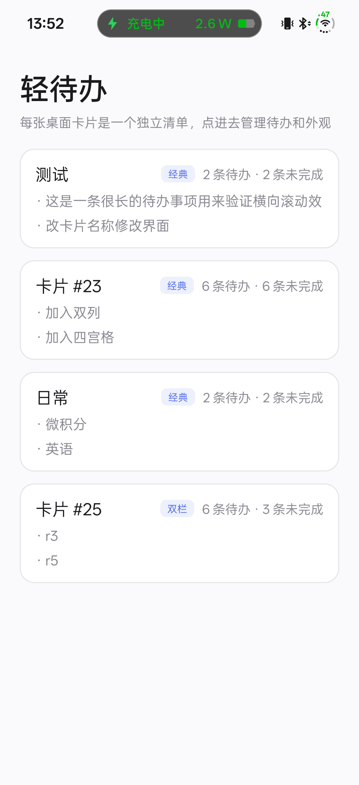
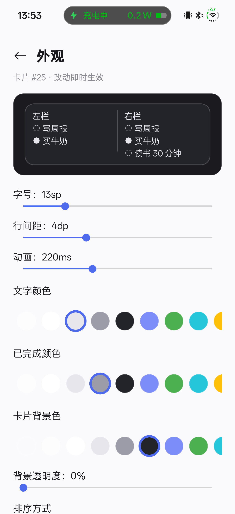
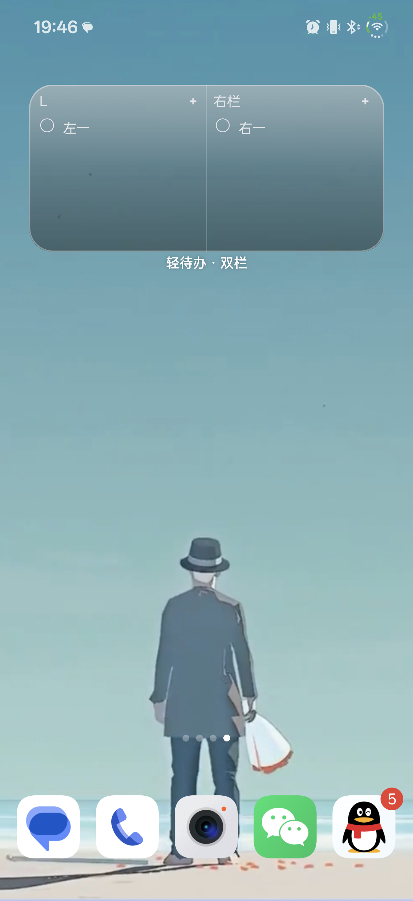
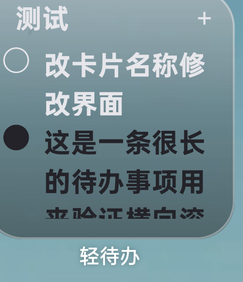

# 轻待办 LightTodo（验证版）

一个 Android 桌面小组件待办 App，目标是把这条链路先跑通：

> App 里加待办 → 桌面小组件显示 → 在小组件上点一下勾选完成 → App 内同步

**当前状态**：已在本机（JDK 21 + Gradle 8.7 + AGP 8.5.2）编译出 `app-debug.apk`，并在 **OnePlus CPH2747（Android 16）真机**与模拟器 API 37 上跑通主链路：桌面添加小组件 → 显示待办 → 点小组件勾选（数据落盘）→ App 内同步 → 重启后小组件仍显示且可点。现在每个桌面卡片是**一个独立清单**：App 首页只做卡片简要展示，点进去编辑这个清单的待办、并配置这张卡片的字号/行距/颜色/标题。小组件上点圆圈=勾选、点文字=编辑该条、点空白=新建，改完 1–2 秒内自动同步。剩余未验证项见第四节。

---

## 一、目录结构

```
settings.gradle.kts            工程与仓库配置
build.gradle.kts               插件版本（AGP 8.5.2 / Kotlin 1.9.24）
gradle.properties
app/build.gradle.kts           compileSdk 34 / minSdk 26
app/proguard-rules.pro         保留小组件 receiver / activity 类名（exported 入口）
app/src/main/AndroidManifest.xml        注册 MainActivity 与小组件 Receiver
app/src/main/java/com/lighttodo/app/
  MainActivity.kt                       首页：桌面卡片列表（每张卡一个清单的简要展示）
  CardDetailActivity.kt                 单张卡片：待办增删改 + 外观设置入口
  EditTodoActivity.kt                   单条待办编辑（边打字边自动保存）
  data/TodoItem.kt                      数据模型
  data/TodoRepository.kt                唯一数据入口：按卡片隔离的列表 + 持久化（list_<appWidgetId>）
  widget/WidgetRenderer.kt              用 RemoteViews 拼卡片：颜色/字号/行距/行数/点击 PendingIntent
  widget/TodoWidgetReceiver.kt          AppWidgetProvider：onUpdate/拉伸/onDeleted + 卡片内点击入口
  widget/WidgetConfig.kt                每个实例的配置（字号/颜色/行距/标题显隐/卡片名称/卡片标题）
  widget/WidgetUpdater.kt               统一刷新出口（update / updateAll / refreshNow）
  WidgetSettingsActivity.kt             外观设置页：实例列表 + 单实例编辑（含两个名称输入框）
app/src/main/res/
  layout/activity_main.xml              宿主页布局
  layout/widget_card.xml / widget_row.xml 卡片与单行布局（RemoteViews 用）
  xml/todo_widget_info.xml              小组件尺寸、预览、更新策略
  values/strings.xml colors.xml themes.xml
  drawable/ic_launcher.xml              矢量图标
```

## 二、环境要求（本次实际验证过的组合）

| 组件 | 版本 / 路径 |
|---|---|
| JDK | 21.0.8（Android Studio 自带 JBR 是 JDK 25，Gradle 8.7 不兼容） |
| Gradle | 8.7（`gradle.bat`，非 wrapper） |
| AGP / Kotlin | 8.5.2 / 1.9.24 |
| Android SDK Platform | 34（首次构建由 AGP 自动下载） |
| Build-Tools | 34.0.0 |
| 运行环境 | 模拟器 API 37（google_apis_playstore x86_64） |

需要用到的环境变量：

```powershell
$env:JAVA_HOME      = 'C:\Program Files\Android\openjdk\jdk-21.0.8'
$env:GRADLE_USER_HOME = '<项目根>\.gradle-home'     # 避免写系统盘 .gradle
$env:ANDROID_HOME   = '<项目根>\.android-sdk'        # 只放 licenses + platform-tools，platform/build-tools 由 AGP 下载
$env:ANDROID_USER_HOME = '<项目根>\.android'         # emulator/AVD 数据
```

> 项目路径含中文时，`gradle.properties` 里的 `android.overridePathCheck=true` 是必需的（AGP 默认直接拦截非 ASCII 路径）。

## 三、构建与运行

命令行构建（已验证通过）：

```powershell
$root = '<项目根>'
$env:JAVA_HOME = 'C:\Program Files\Android\openjdk\jdk-21.0.8'
$env:GRADLE_USER_HOME = "$root\.gradle-home"
$env:ANDROID_HOME = "$root\.android-sdk"
& "$root\.tools\gradle-8.7\bin\gradle.bat" -p $root :app:assembleDebug --console=plain
# 产物：app\build\outputs\apk\debug\app-debug.apk
```

安装与添加小组件：

```powershell
adb install -r app\build\outputs\apk\debug\app-debug.apk
adb shell am start -n com.lighttodo.app/.MainActivity
# 桌面长按空白处 → 小组件 → 轻待办 → 长按预览拖到桌面
```

Android Studio 路线：**Open** 选项目根目录 → Sync → Run。仓库没有提交 `gradle/wrapper/`，Android Studio 会自动补齐，或命令行执行 `gradle wrapper --gradle-version 8.7`。

## 四、验收清单（真机实测结果）

测试机型：OnePlus CPH2747（Android 16 / ColorOS 16，1272×2772）。模拟器 API 37 上也跑过同样流程。

- [x] App 启动显示空状态（模拟器与真机均验证）
- [x] 添加 3 条待办 → 列表出现，未完成排在上面
- [x] 桌面小组件显示这些待办，按「未完成在前、已完成沉底」排序
- [x] 点小组件里某一条 → 数据落盘（`run-as` 读 `shared_prefs/light_todo.xml` 确认 `done` 翻转）
- [x] 在 App 内勾选 → 小组件数据同步（真机）
- [x] 点小组件卡片空白处（含隐藏标题后的底部区域）→ 拉起 App 且输入框聚焦（模拟器验证；真机进入的是同一入口）
- [x] 从最近任务划掉 App 再打开 → 数据还在
- [x] 重启手机 → 小组件仍显示真实内容且可点（真机 adb reboot 验证，无占位、无需先打开 App）
- [x] 在 App 内删除 → 小组件同步（代码路径与勾选一致，未单独回归）
- [x] 每个实例独立外观：两组实例分别设成「20sp / 行距 12dp / 隐藏标题 / 深色」与「13sp / 行距 4dp / 显示标题」，互不影响（真机 #16 / #17 验证）
- [x] 调字号 / 行距 / 颜色 / 隐藏标题 → 保存后桌面即时生效，并写入 `shared_prefs/light_todo_widget_cfg.xml`（`cfg_<id>`）
- [x] 隐藏标题后点卡片下部空白区域 → 仍能拉起 App 新建（真机 #16 验证；点击目标是卡片正文，不再依赖底部入口行）
- [x] 点未隐藏的标题「待办清单」→ 直达该实例的外观设置页（真机 #17 验证）
- [x] 一卡一清单：卡片 #16 与 #17 内容互相独立（#16 有 5 条、#17 为空）
- [x] App 首页 = 卡片列表（标题/条数/前两条预览），点卡片进详情；详情里能增删改 + 进「外观」
- [x] 小组件点圆圈 → 只切换完成；点文字 → 打开该条待办的编辑页
- [x] 编辑页改字后自动保存并刷新卡片（真机把一条改成 "2024"，桌面 1–2 秒内同步）
- [x] 外观设置改成即时生效：拖完滑块 / 点色块 / 勾选标题就应用，无需点保存
- [ ] 拉伸到 2×2 → 未完成自动验证（ColorOS 的缩放把手用 adb 拖拽没命中，需手动拖一次）；代码已按 `LocalSize` 自适应，`minResizeWidth/Height` 已放到 110dp 允许 2×2
- [ ] 4×2 → 4×3 / 4×4 拉伸后字号不变 → 同上，需手动拖一次确认

> 真机上发现的**刷新延迟**：点小组件后数据立即落盘，Glance 也会用新数据重新渲染并 `updateAppWidget`（logcat 可见 `updateAppWidgetIds`），但 ColorOS 桌面会延迟几十秒才重绘。模拟器上延迟 1–3 秒。这不是数据或渲染问题，是 OEM 桌面的小组件刷新节流；重启/重装后首次绑定是即时的。

## 四之一、小组件尺寸适配（已修）

- 原来固定 `MAX_ITEMS = 5` 行，在真机 4×2（实际约 110–130dp 高）上会把最后一行裁掉。
- 改为按 `LocalSize` 动态算行数，并把 `sizeMode` 覆盖成 `SizeMode.Exact`——默认的 `SizeMode.Single` 只会给出最小尺寸（110dp），行数会算少。
- 行高 26dp、标题栏+底部入口 72dp 为估算值；超出部分显示「还有 N 条…」。

## 四之三、一卡一清单（每张桌面卡片各自独立）

- 数据按卡片隔离：一个桌面小组件实例（appWidgetId）就是一个清单，存储键 `list_<appWidgetId>`。
- 旧版本那份全局列表（`items_json`）会在首次运行时自动迁移到第一个实例，迁移后删掉旧键。
- **App 首页**：列出桌面上所有「轻待办」卡片，每行显示 `卡片 #id`、`N 条待办 · M 条未完成`、前两条未完成内容；点进去才是这张卡的待办编辑与「外观」入口。
- **卡片详情页**：点圆圈勾选、点文字进单条编辑、右侧删除、顶部「外观」进该实例的配色/字号设置。
- **小组件上的点击**：圆圈只负责完成/取消；点文字打开这条待办的编辑页；点空白处新建。
- 每条写操作（新增/勾选/改名/删除/改外观）完成后立刻刷新对应那张卡片，不再有「保存」按钮；单条编辑是 400ms 防抖自动保存，离开页面时再兜底提交一次。
- 刷新链路：`WidgetUpdater.refreshNow(context, listId)` 先按 id 精确更新，再 `updateAll` 兜底一遍；小组件回调里 await，避免广播返回后进程被回收丢刷新。
## 四之三、外观设置（per-instance）

每个小组件实例有独立的配置，存在 `light_todo_widget_cfg` 里，键是 `cfg_<appWidgetId>`：

| 项 | 范围 / 取值 | 默认 |
|---|---|---|
| 字号 | 11–20sp，步进 1 | 13sp |
| 行间距 | 0–12dp，步进 1 | 4dp |
| 正文颜色 | 12 色预设 + HEX 输入（6/8 位） | `#FFE6E6EC` |
| 已完成颜色 | 同上 | `#FF9C9CA8` |
| 卡片背景色 | 同上 | `#FF23232A` |
| 顶部标题 | 显示 / 隐藏 | 显示 |

入口有两个：

1. **App 内主入口**：标题下的「小组件外观设置 ›」→ 实例列表（显示每个实例当前字号/行距/标题状态）→ 点某个实例进编辑页。ColorOS 长按小组件只会弹系统菜单，插不了自定义项，所以主入口放在 App 里。
2. **小组件次入口**：点标题「待办清单」（标题未隐藏时生效）直接进当前实例的编辑页。

编辑页里拖完滑块 / 点色块 / 勾选标题就立即落盘并刷新这张卡片（不需要点保存）；删除实例时 `onDeleted` 会删掉对应 `cfg_<id>`。

适配细节：

- 行数按 `LocalSize` 实时算（`(高 - chrome) / 行高`），行高 = `字号 × 1.45 + 行距`，不写死条数。
- 字号只来自配置，不随尺寸二次缩放——所以拉伸到 4×3 / 4×4 时字号不会变，只是条数变多。
- 有溢出时先扣一行给「还有 N 条…」，避免贴底被裁。
- 2×2 也能放下至少 1 条；不再保留固定「＋新建待办」行，点卡片任意空白处即可新建。

## 五、这个验证版故意做的取舍

| 项 | 验证版做法 | 原因 / 后续 |
|---|---|---|
| 持久化 | SharedPreferences + JSON | 少一个 KSP 依赖，构建更稳；`TodoRepository` 是唯一入口，换 Room 只改它 |
| 小组件配色 | 每个实例可配（预设 + HEX），默认深色卡片 | 深浅壁纸都读得清；暂不做 day/night 与动态取色 |
| 列表 | 按高度显示 N 条 + 「还有 N 条…」 | 避免 Glance 集合控件的坑；后续换 `LazyColumn` 支持滚动 |
| 刷新 | 只在数据变更时刷新（`updatePeriodMillis=0`） | 最省电；后续加 WorkManager 做跨天/逾期刷新 |
| 功能 | 单清单、无提醒、无发布配置 | 先验证主链路 |

## 六、容易踩的坑（已处理）

- **Glance 依赖 Compose 编译器**：`buildFeatures.compose = true` + `composeOptions` 缺一不可，否则 `@Composable` 编译失败。
- **点击动作靠反射实例化**：`ToggleTodoAction` 等类在 release 开启 R8 后会被裁剪，`proguard-rules.pro` 已加 keep 规则。
- **`ActionCallback` 的包名**：在 `androidx.glance.appwidget.action.ActionCallback`，不在 `androidx.glance.action`，import 错会报「不在类型参数边界内」。
- **数据要在 `provideContent` 的 lambda 里读**：提前捕获 `todos` 会让重组一直用旧列表。
- **`updatePeriodMillis` 最小 30 分钟**：这里直接设 0 关掉系统轮询，改成数据变更驱动 `updateAll`。
- **国产 ROM 后台限制**：ColorOS 会节流桌面小组件重绘；验证时建议把 App 加入电池优化白名单。
- **构建期签名锁**：AGP 的 `validateSigningDebug` 会写 `%USERPROFILE%\.android\debug.keystore.lock`，沙箱受限时需要完整文件权限，否则报 `AccessDeniedException`。

## 七、下一步

1. `TodoRepository` 内部换 Room（保留对外接口不变）
2. 小组件深浅色自适应 / Android 12+ 动态取色
3. 可滚动列表、多清单、条目点击进详情
4. WorkManager 每日刷新（跨天、逾期标红）
5. 发布配置（签名、图标、商店素材）—— 当前明确不做

## 四之四、显示密度与返回栈（v3）

一、密度
- 行高系数从 1.45 降到 **1.2**：`rowHeightDp = fontSizeSp * 1.2 + rowSpacingDp`，同样高度多放 1–2 行。
- 卡片外边距全部移到子视图内部（标题 8dp、列表左右 6dp），**卡片最顶/最底/左右边缘都落在可点击区域上**，没有点不到的死区。
- 标题行贴卡片顶边、**右对齐**（`gravity=end`），`＋` 在最右侧；标题只占 `fontSizeSp * 1.25 + 2dp`。
- 隐藏标题时改用 `layout/widget_card_notitle.xml`：顶部只留 **8dp** 的点击带（点它进卡片界面），内容整体上移。
- `targetCellWidth` 改为 2，避免 4 格默认尺寸被桌面缩放到 2 格时整体位移/缩放。

二、点击分区
| 位置 | 动作 |
|---|---|
| 标题行 / 隐藏时的 8dp 顶带 | 进该卡片详情页 |
| 每行圆圈 | 切换完成状态 |
| 每行文字 | 编辑这一条 |
| 列表空白（含卡片最底部） | 进详情页并聚焦输入框 |
| 标题右侧 `＋` | 同上 |

三、返回栈
从桌面卡片直接进入的页面，会先用 `startActivities` 补出「首页 → 卡片详情」两层，再压目标页：

```
桌面 → 卡片详情 → 编辑待办     返回：编辑 → 卡片详情 → 首页 → 桌面
桌面 → 卡片详情                返回：卡片详情 → 首页 → 桌面
```

之前是 `FLAG_ACTIVITY_NEW_TASK` 单发，App 没在运行时目标页会成为根页面，一按返回就退回桌面；现在不会。
## 四之四、ListView 方案（v4）

- 卡片内用 `ListView` 滚动（`RemoteViewsService` + `RemoteViewsFactory`，见 `widget/TodoWidgetService.kt`），行布局 `res/layout/widget_row.xml`。
- 行内点击必须 `setPendingIntentTemplate` + `setOnClickFillInIntent`，模板 PendingIntent 必须带 `FLAG_MUTABLE`；**绝不能**对 ListView 调 `setOnClickPendingIntent`，否则桌面直接显示「载入窗口小部件时出现问题」（logcat: `Don't call setOnClickListener for an AdapterView`）。
- 点击分区：圆圈=勾选、文字=编辑、行内其余区域=新建（由 fillInIntent 的 `item_action=add` 承担）。
- 排序：`sortForDisplay(items, newestFirst)`，顺序为「置顶 → 未完成 → 最后修改时间（正/倒序）→ id」；`updatedAt` 在改文字/勾选时刷新，新建取创建时间。
- 置顶：App 卡片详情页每行的 ☆/★。
- 已知限制：刷新列表后 ListView 会保留上次滚动位置，新排序的头部可能被滚出视口，需手动上滑。
## 四之五、v5：动作排序、图钉、预览图、液态玻璃

- 排序补了 `movedAt`：勾选/取消完成时写入当前时间，`sortForDisplay` 在「置顶 → 未完成/已完成」之后先比 `movedAt` 倒序。效果：刚取消完成 → 未完成组第一条；刚完成 → 已完成组第一条，且不受「最新/最早在前」开关影响。
- 置顶图标从 ★/☆ 换成矢量图钉（`res/drawable/ic_pin_on.xml`、`ic_pin_off.xml`）。
- 标题左边距 `TITLE_PADDING_START_DP = 14f`（代码里 `setViewPadding`，改 XML 不生效）。
- 小组件选择器预览：`todo_widget_info.xml` 的 `previewLayout` 指向 `res/layout/widget_preview.xml`，长按桌面 → 卡片 → 轻待办可看到示意内容。
- 液态玻璃：外观页勾选「液态玻璃效果」，卡片改用 `res/drawable/widget_bg_glass.xml`（半透明深底 + 顶部高光渐变 + 1dp 亮边）。RemoteViews 拿不到壁纸像素，没有真正的背景模糊，这是可行的近似；需要更强可读性就关掉它用纯色底。
## 四之六、v6：名称统一、显示已完成、界面改版

- 「卡片名称」与「小组件顶部标题」合并为一个字段 `cardName`：App 首页卡片标题、详情页标题、小组件顶部都用它，留空则回退「卡片 #id」。旧配置里的 `headerTitle` 仍会读入（优先 `cardName`，为空时用 `headerTitle`），写盘时两者同值，兼容老数据。
- 改名入口：卡片详情页**长按标题**弹「卡片名称」对话框；外观页不再有名称输入框。
- 新增「显示已完成的待办」开关：关掉后小组件只列未完成项（App 详情页仍显示全部），配置键 `showDone`。
- 外观页改版：顶栏「← 外观 · 卡片名 · 改动即时生效」，预览放进深色底托（玻璃效果可辨），勾选项依次为「隐藏顶部「卡片名」标题」「显示已完成的待办」「液态玻璃效果」。
- 卡片详情页改版：返回箭头 + 卡片名 + 「外观」胶囊按钮；输入框圆角 + 「添加」胶囊；每行是圆角卡片（圆圈 / 文字 / 图钉 / 删除）。
## 四之七、v7：外观页交互修正

- 行间距滑杆现在会实时刷新预览（`refreshPreview()` 里 `preview.setLineSpacing(dp(rowSpacingDp), 1f)`）；此前 onChange 只改配置不重绘。
- 颜色选择改为「只用色块」：去掉 HEX 输入框，选中色块加 `3dp` 品牌色描边环并放大约 1.12×，未选中是 1dp 半透明白边。
- 背景色支持透明：色板新增「透明」「半透明白」两项；另有「背景透明度」滑杆（0–100%，写回 alpha 通道）。开启液态玻璃时颜色/透明度被玻璃底覆盖，需先关玻璃。
- 「完成」按钮已删除——每次改动（滑杆、色块、开关、单选）立即写盘并刷新卡片。
- 小组件文字尺寸单位由 sp 改为 dp，避免系统字体缩放参与；字号仍只来自卡片配置。
## 四之八、v8：拖拽排序、沉底开关、粗体、长文本

- **长文本不再省略号**：`widget_row.xml` 里的 label 去掉 `maxLines=1` / `ellipsize="end"`，改为自动换行、完整显示；圆圈随首行顶部对齐（`gravity=top` + 2dp padding）。
  - 原本想做「行内横向滑动」，实测**不可行**：`RemoteViews` 只接受带 `@RemoteView` 的 View，`HorizontalScrollView` 不在其中，放进集合行后桌面会把整行回退成「无法添加微件」（logcat：`AppWidgetHostView: getErrorView … RemoteCollectionItemsAdapter.getView`）。因此改用换行展示，超过卡片高度时上下滚动列表查看；点文字仍可进编辑页看全文。
- **详情页拖拽排序**：`CardDetailActivity` 从 `ScrollView + LinearLayout` 改为 `RecyclerView + ItemTouchHelper`。长按任意行（圆圈/文字/图钉/删除都行）开始拖动，上下拖动换位，松手写盘。
  - 新增 `TodoItem.order`（Long，0 表示「没手动排过」）与 `TodoRepository.applyOrder(listId, orderedIds, unpinId)`，order 按 `(index+1)*1000` 重排。
  - 拖动的是置顶项时，落盘会把该条 `pinned` 一并置 false —— 拖到哪儿就留在哪儿，不会被置顶规则再顶回顶部。
  - `sortForDisplay` 新顺序：置顶 → （可选）已完成沉底 → 手动 order → `movedAt` 倒序 → 最新/最早 → id。
- **「已完成的待办沉到底部」开关**（配置键 `sinkDone`，默认开）：关掉后已完成项按 order 留在原位，不再被压到末尾。
- **「文字加粗」开关**（配置键 `bold`，默认关）：行文字与顶部标题都加粗。`RemoteViews` 没有 `setTextViewTextStyle`（编译期直接 unresolved），改用 `SpannableString` + `StyleSpan(Typeface.BOLD)`。
- **色板描边不再被裁**：色块容器左右各留 6dp 内边距，外层 `HorizontalScrollView` 设 `clipToPadding=false`，选中第一个色块时 3dp 描边环完整可见。
  - 顺带修掉一个逻辑坑：文字颜色/已完成颜色的色板不再提供「全透明」色块（之前选中它会让文字直接看不见），卡片背景色仍保留透明选项。
- 外观页字号标签恢复 `sp` 后缀（`字号：17sp`）。

## 四之九、v9：下沉/上浮动画与点击延迟

- **详情页动画**：`CardDetailActivity` 的 `submit()` 由 `notifyDataSetChanged()` 改为 `DiffUtil` 派发更新（`areItemsTheSame` 比 id、`areContentsTheSame` 比整个 `TodoItem`），配合 `RowItemAnimator : DefaultItemAnimator`（`supportsChangeAnimations = true`），勾选后该行先变更样式、再以位移滑到「已完成」区，取消勾选反向回弹；`animMs = 0` 时直接 `itemAnimator = null`，瞬间到位。
  - 时长由 `WidgetConfig.animMs` 决定（0–600ms，默认 220），四个时长（add/remove/move/change）统一取值，才会「位移 + 淡入」同时变快变慢。
- **外观页新增「动画」滑杆**（`animMs`，0 显示「动画：关闭」）：写在字号/行间距之下，松手即写盘并刷新卡片。
- **卡片动画**：RemoteViews 做不到逐行动画，改为整卡淡入——`WidgetRenderer.render(context, id, fadeMs)` 在 `SDK >= 31` 且 `fadeMs > 0` 时先 `setFloat(R.id.card_root, "setAlpha", 0.45f)` 再下发，随后按 `[0.66, 0.84, 1.0]` 分三步补发（每步 `max(fadeMs/4, 24)` ms）。低于 Android 12 或 `animMs = 0` 自动退化为即时重排。
  - 代价：`animMs > 0` 时桌面会多次重绑集合（实测 220ms 时在 +71/+129/+188ms 各一次），也就是「淡入」本身；如果 OEM 桌面吞掉这些帧，效果会退化成「直接出现」，数据与顺序仍正确。
- **点击延迟测量**：新增 `LightTodoPerf` 日志（`toggleAsync` 写盘段 + dispatch 段；`TodoViewsFactory.onDataSetChanged` 的 `sinceToggle`）。
  - 实测（OnePlus CPH2747 / ColorOS，卡片 20）：`write` 1–8ms、`dispatch` 2–9ms，点击后约 11ms 桌面就开始重新绑定集合 → **延迟不在落盘，而在桌面重排/重绘**。
  - 隐藏标题、`animMs=0` 时最省：`write` 0–1ms、`dispatch` 3ms、集合只重绑一次（`sinceToggle=1–2ms`）。
  - 连续快速点 5 次：5 次 toggle 全部落盘，最终状态为奇数次翻转（不丢事件、不串行阻塞）。
- 取舍：**没有做乐观更新**（先改 UI 再等写盘），避免「界面显示已完成但实际没写进去」的不一致；优化集中在减少不必要重绘（`refreshRows` 只 notify 集合）与把耗时分段量化。

## 四之十、v10：双栏卡片、改名弹窗、详情页提示

- **锁屏卡片**：Android 5.0 起系统移除了第三方应用往锁屏添加 AppWidget 的公开 API（`AppWidgetHost` 只有一个，锁屏由系统/厂商自己托管），因此「锁屏放卡片」无法实现；2×1 尺寸也因此没有补做（桌面端可把经典卡片手动缩到 2×1）。
- **双栏卡片**：新增第二个 Provider「轻待办 · 双栏」（`DualWidgetReceiver` + `todo_widget_info_dual.xml`，最小 4×2），经典 Provider 的 label 改为「轻待办 · 经典」。
  - `TodoItem.column`（0 左 / 1 右）+ `WidgetConfig.dual/leftTitle/rightTitle`；两栏各一套 `TodoViewsFactory`（`adapterIntent` 的 data URI 带 `?column=N`），集合各用 `rows_left` / `rows_right`，`refreshRows` 双栏时同时 notify 两个 id。
  - App 详情页顶部出现「左栏 / 右栏」胶囊（仅双栏卡片显示），在哪个栏的输入框添加，条目就归到哪一栏。
  - 踩坑：`widget_dual.xml` 中缝原来用裸 `<View>`，桌面报 `InflateException: Class not allowed to be inflated android.view.View` → 换成同样式的 `TextView` 即可；RemoteViews 的白名单比想象中更窄。
  - 双栏预览图单独做了 `widget_preview_dual.xml`（左右两列 + 中缝示意图），添加卡片时第 2 页不再是经典样式的截图。
- **详情页标题提示**：标题右侧 10sp 次要色小字「长按标题可修改卡片名称」；标题过长时自身 `ellipsize=end`，不会挤掉提示。
- **改名弹窗改自绘**：不再用系统 `AlertDialog`，换成 `dialog_rename_card.xml`（白底 20dp 圆角 + 圆角输入框 + 品牌色「保存」胶囊 + 文字「取消」），说明行按 `listId` 动态格式化为「留空则显示「卡片 #25」」。
- 工程教训：**不要用 PowerShell 做源码文本替换**。本轮 `(Get-Content -Raw).Replace(...) | Set-Content -Encoding utf8` 把 `WidgetRenderer.kt` 的 UTF-8 中文按 GBK 读坏，注释变乱码、换行被吞、注释与代码拼行，`Class not allowed` 之外的编译错误一堆；由于仓库没有 git，只能整文件重写。以后一律用 edit/write 工具改源码。

## 四之十一、v10.1

1. 首页支持双栏卡片：`MainActivity.listIds()` 同时取 `TodoWidgetReceiver` 与 `DualWidgetReceiver` 的 appWidgetId（`distinct().sorted()`），每张卡片右侧用胶囊标注类型（经典 / 双栏，`bg_type_chip.xml`）。
2. 外观页预览支持双栏：`WidgetSettingsActivity` 的预览由单个 TextView 改为「左列 + 中缝 + 右列」结构，`config.dual` 为真时展示两列各自的「栏名 + 示例条目」。
3. 双栏卡片每栏都有自己的入口：点栏内「+」、栏内空白（空态铺满整栏）、或任意一条待办，都会带上 `EXTRA_COLUMN` 进入 `CardDetailActivity`，详情页自动选中对应栏。
4. 栏名可改：详情页「左栏 / 右栏」胶囊长按 → 与改卡片名同一套圆角弹窗（标题为「修改栏名称」）；RemoteViews 不支持长按，所以桌面卡片上没有长按入口，改名请在 App 内完成。
5. 圆圈与热区放大：详情页圆圈 24sp + 最小 44×40dp + 8dp 内边距；桌面行圆圈在字号基础上 +5dp 并加左右内边距，点起来更容易命中。
6. 踩坑：给「包着 AdapterView 的容器」设 `setOnClickPendingIntent` 会让整份 RemoteViews 的点击失效（视觉上仍能显示，因为行视图由 RemoteViewsService 单独刷新）；栏内空白入口应交给叶子控件（标题、加号、空态）承担。
## 四之十二、v1.1.0（versionCode 2）

1. 多行待办不再被裁：`widget_row.xml` 的 `label` 去掉 `includeFontPadding="false"` 并加 1dp 底部内边距，圆点是单行所以保留该属性用于对齐。
2. 液态玻璃重写为 Apple Liquid Glass 风格（`widget_bg_glass.xml`，22dp 圆角五层）：暗底 + 冷白磨砂 + 顶部镜面高光 + 底部渐暗 + 1dp 亮边。原来的 16dp 圆角、单层半透明白已废弃。
3. 玻璃卡片内容内缩：`WidgetRenderer` 里玻璃时标题行左右 +4dp、顶部 +6dp，列表左右 +4dp、底部 +12dp；双栏的左右栏各自内缩（左 10/8/2、右 6/8/8，底部 12dp）。这样最后一行停在圆角上方的留白里，不再压到卡片边缘。
4. 踩坑记录：`RemoteViews` 只能反射调用带 `@RemotableViewMethod` 的方法。用 `setBoolean(R.id.rows, "setClipToPadding", false)` 会让**整份** RemoteViews 应用失败，桌面直接显示「载入窗口小部件时出现问题」；列表的裁切行为只能靠布局里的 `android:clipToPadding` 决定。
5. 教训：`<item>` 的 `android:top/bottom` 不接受百分比（AAPT 报 `'55%' is incompatible with attribute bottom (attr) dimension`），分层只能靠渐变自身的衰减。

## 截图

| 首页（含类型标签） | 外观页（双栏预览） |
| --- | --- |
|  |  |

| 桌面双栏卡片（液态玻璃） | 经典卡片玻璃底细节 |
| --- | --- |
|  |  |